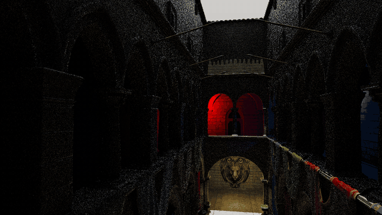
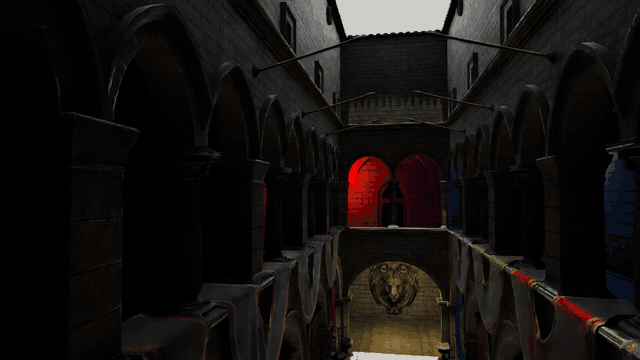
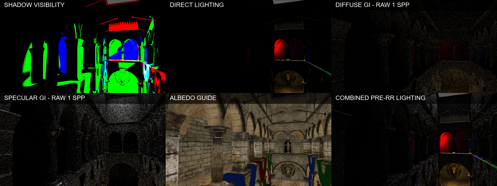
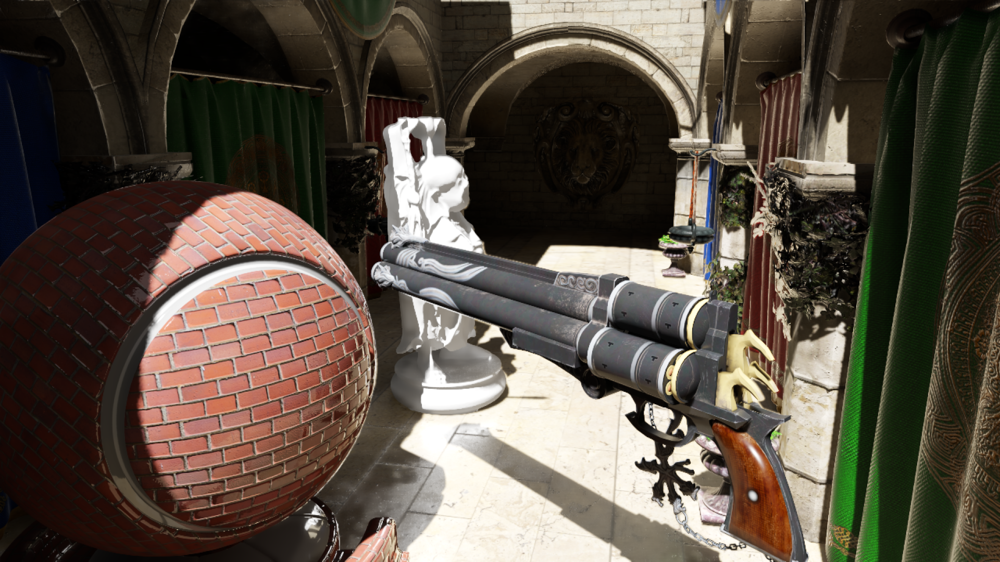
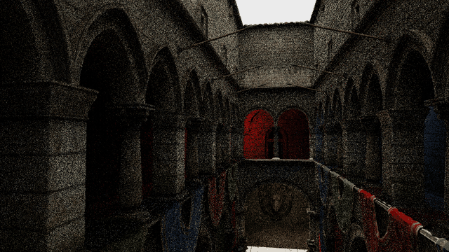
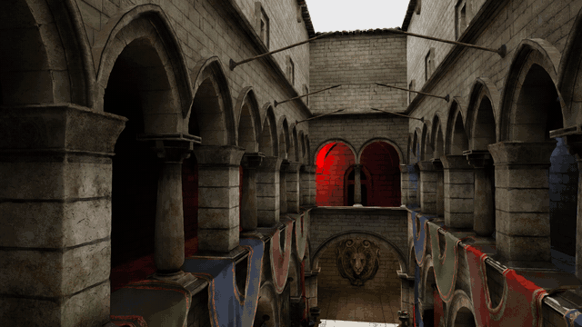
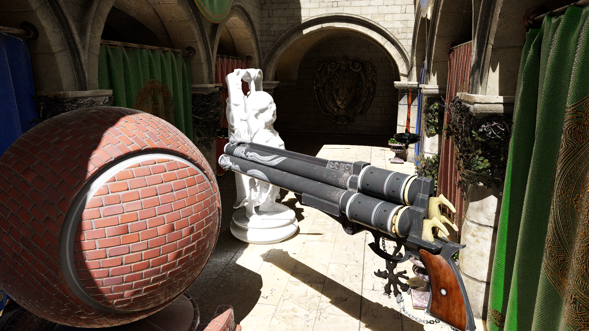
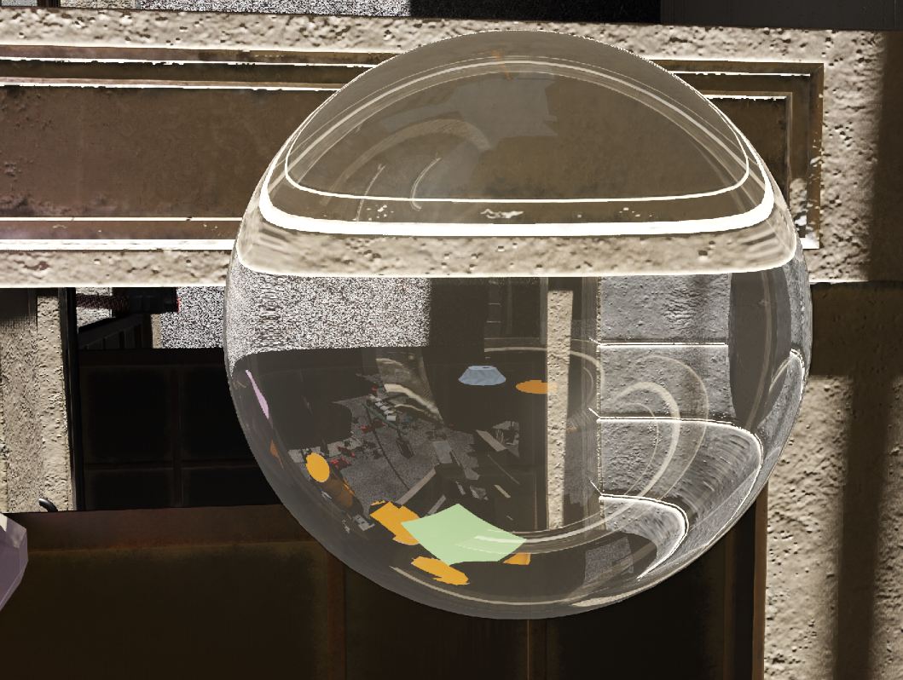
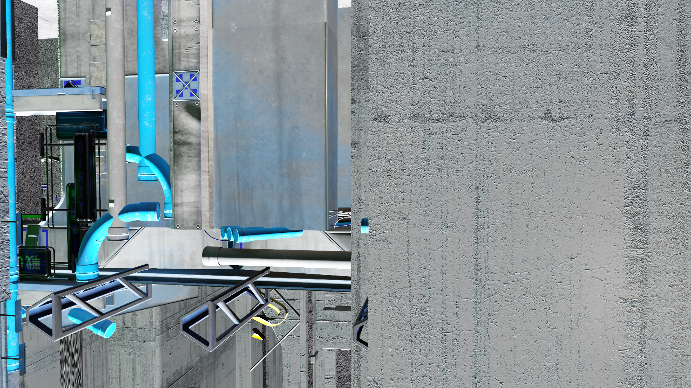

# Corona

Corona is a research-oriented real-time ray-traced renderer built around DLSS
Ray Reconstruction. It is a platform for experimenting with low-sample-count
lighting, reconstruction-friendly signal generation and graphics backends, not
a game engine. Its two rendering paths are designed to produce the stable,
physically meaningful signals that DLSS-RR needs, rather than treating Ray
Reconstruction as a final bolt-on denoiser.

## Real-time capture

The following matching five-second loops were recorded directly from Corona's
30fps frame-capture path. They use the same camera motion and 1 spp hybrid
lighting. Optimized animated images make the raw signal and reconstructed
result play directly in the README without an external link or player.

**Raw 1 spp hybrid lighting — ray-traced shadows, reflection and Simple Diffuse GI, without reconstruction**



**DLSS-RR output — the same frames and signals after reconstruction**



## Rendering techniques

Corona's stochastic ray-traced passes are designed around sparse,
low-sample-count signals. Shadows, reflections and Simple Diffuse GI emit
single-sample signals, while the real-time path tracer starts a small number of
primary paths and continues them across multiple bounces. Matching depth,
normal, material, motion and specular guides are generated alongside the noisy
radiance so DLSS-RR can reconstruct a stable image. This shared signal contract
is the core design constraint of the renderer, not an after-the-fact denoising
option.

### Deferred renderer

The hybrid deferred renderer combines rasterized material visibility with
ray-traced shadows, reflections, ambient occlusion and diffuse GI. Lighting is
assembled before Ray Reconstruction, while the G-buffer supplies consistent
depth, albedo, shading and geometry normals, roughness/metallic, motion vectors,
specular hit distance and specular motion. Jitter, disocclusion handling and
stochastic ray sampling are tuned together so DLSS-RR receives useful temporal
signals instead of structured noise or mismatched guides.

The deferred path first rasterizes material and geometric guides, then builds
lighting as a sequence of explicit signals: ray-traced shadow visibility,
deferred direct lighting, 1 spp Simple Diffuse GI and 1 spp specular GI. These
signals are combined into the pre-RR lighting buffer and submitted with albedo,
depth, shading/geometric normals, roughness/metallic and motion guides. DLSS-RR
therefore receives both the noisy lighting and the surface data needed to
reconstruct it coherently.

The default **Simple Diffuse GI** traces one diffuse bounce per pixel and is
specifically tuned for DLSS-RR. Screen-probe and spatial-hash GI remain
secondary experimental implementations. The board below shows one matching
frame at each major stage; the direct-light diagnostic view isolates the
non-GI contribution from the combined pre-RR lighting signal.





### Real-time path tracing with DLSS-RR as the denoiser

The path tracer follows low-sample-count primary paths through multiple
bounces, covering direct and indirect illumination, GGX reflection,
transmission and local lights. To make DLSS-RR applicable to a fully ray-traced
image, the primary ray also generates the G-buffer directly from its first
surface hit: depth, albedo, shading and geometry normals, roughness/metallic and
motion are written from the same hit that seeds the path. This keeps
reconstructed radiance and its guides spatially consistent. With DLSS-RR as the
sole reconstruction and denoising stage, the renderer can produce clean
real-time output without a separate path-tracing denoiser. Primary-ray
stabilization, specular motion/hit-distance guides and optional wavefront path
compaction keep the signal both reconstructable and efficient.

**Raw low-sample, multi-bounce path-traced radiance — no reconstruction or separate denoiser**



**DLSS-RR output — matching camera path and low-sample input**





### Refraction-aware G-buffer warp

Transparent surfaces need guides that follow the refracted image, not the
original camera ray. Corona's G-buffer warp stores a screen-space receiver
offset for raster refraction, or the final opaque-hit UV for RT-primary
refraction, and warps depth, normals, material data and motion into that same
receiver space before lighting and DLSS-RR. The aligned color and guide signals
substantially reduce refraction noise, ghosting and warped-shadow artifacts;
dielectric reflection, transmission and volume scattering remain inside the
shared DLSS-RR denoising path.



## DX12, Vulkan and NRI backends

A shared RHI keeps renderer code independent from the graphics API and allows
DX12, native Vulkan and NVIDIA NRI backends to coexist in the same codebase.
DX12 is the full-feature path and currently owns the Streamline/DLSS-RR
integration; Vulkan has native raster, compute and ray-tracing infrastructure;
the optional NRI build is an experimental backend capable of targeting D3D12
or Vulkan without changing the high-level renderer.



## Quick start

Requires Windows 10/11, an NVIDIA RTX GPU, Visual Studio 2022 (Desktop C++),
CMake 3.21+ and Git. PhysX, Luau and MathLib are submodules; the bootstrap also
restores the D3D12 Agility/PIX packages and a local Vulkan SDK.

```powershell
git clone --recurse-submodules https://github.com/kulkal/Corona.git
cd Corona
powershell -ExecutionPolicy Bypass -File scripts\bootstrap_windows.ps1
```

Incremental build: `cmake --build --preset release`. NRI build:
`cmake --preset nri-x64; cmake --build --preset nri-release`.

```bat
editor.bat
bin\Corona.exe --render-mode pathtracing --aa dlss-rr
bin\Corona.exe --backend vulkan --render-mode hybrid --aa taa
bin\Corona.exe --backend nri --render-mode hybrid --aa taa
```

Useful overrides are `--4k`, `--gi-mode simple|screen-probe|spatial-hash`, and
`--exit-after-frames N`. Imported FBX/OBJ meshes are cached as `.cmesh` files on
first load.
